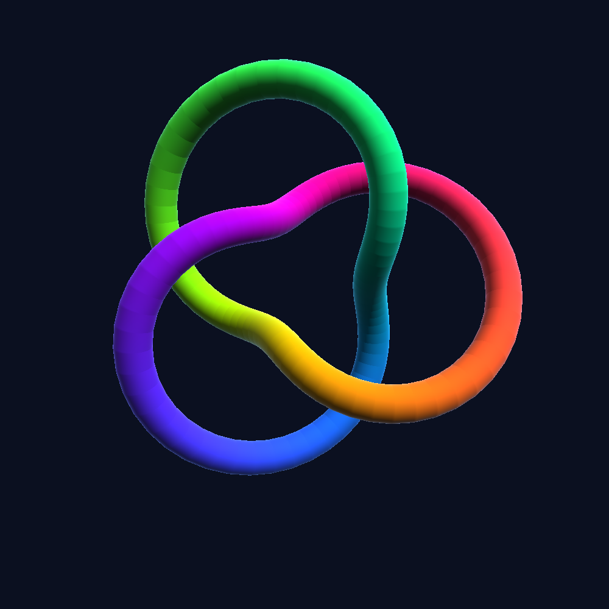
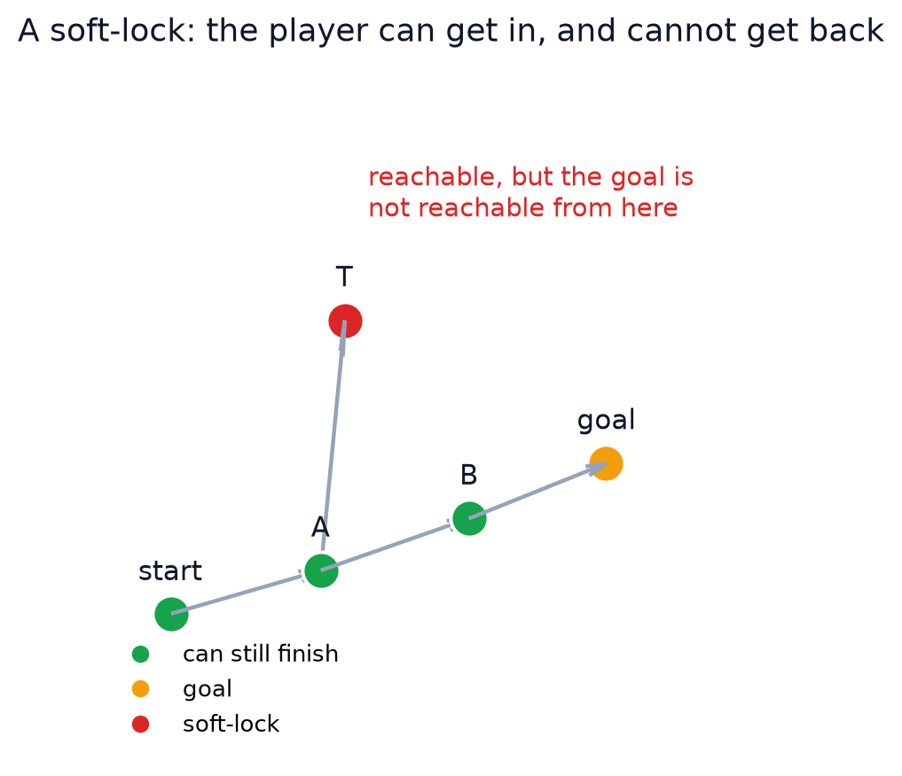

# gxkit

**Agent-native review loops for creative artifacts.** Its job is simple: let an
AI check its own work *before* you have to. Write the artifact as code,
`inspect` it, get problems with stable codes and an exit code, fix them, and
ship — with a storyboard image as the evidence.

<p>
<a href="https://github.com/nekomario28/gxkit/actions/workflows/ci.yml"></a>


</p>

<p align="center"></p>


## The loop

Every tool has the same contract, so an agent learns it once:

```sh
<tool> inspect artifact.py     # report + storyboard; exit 1 on any error
<tool> inspect artifact.py --json
<tool> render  artifact.py -o out.png
```

- **Exit 1** on any `error`; `warn` and `info` never fail the build.
- **Stable codes** — `truncated-baseline`, `soft-lock`, `escalation`, … — so an
  agent branches on the code, never on prose.
- **A storyboard image** with each located problem boxed and numbered, so the
  text report and the picture agree.

## Tools

| tool | inspects | the check only it makes |
| --- | --- | --- |
| `chartgx` | matplotlib charts | a bar chart whose baseline is not zero |
| `levelgx` | game levels | a soft-lock created by a one-way tile |
| `flowgx` | state machines | a state from which "done" is unreachable |
| `protogx` | protocols | a declared message nothing handles |
| `authzgx` | permission models | a low principal reaching a sensitive permission |
| `depsgx` | module graphs | a lower layer importing a higher one |
| `schemagx` | schemas | a foreign-key cycle |
| `docgx` | pages / slides | text that overflows the canvas |
| `shadergx` | fragment shaders | a uniform that never reaches the output |

Each tool also ships `README.md`, `AGENTS.md`, `llms.txt` and `SKILL.md`; the
repository root has [`SKILL.md`](SKILL.md), the family skill that routes to them
all.

## See it catch something

Here is a level an agent wrote. Every cell is reachable, so a naive check
passes — but a one-way tile drops the player into a dead end. `levelgx` walks
the *directed* graph and finds it (the picture below is generated from the same
data):



```sh
$ levelgx inspect softlock.py
inspect: 1 problem (1 error)
  [1] error cell r2c3  soft-lock: 2 reachable cells cannot get back to the goal
                        (e.g. cell r2c3) — a one-way tile makes a dead end
$ echo $?
1
```

The text says which cell; the storyboard image boxes it. That is the whole
idea, repeated for nine domains.

## One core, thin tools

The expensive part of a review loop is the contract, not the checks. `gxcore`
owns it — `model`, `report`, `cli`, `storyboard`, `testing` — plus the analysis
the tools share:

- **`graph`** — reachability, reverse reachability, traps (soft-locks), cycles.
- **`layout`** — text too small, clipped, or overlapping.
- **`diagram`** — a deterministic node-link renderer.
- **`loading`** and **`toolkit`** — load an artifact from a file; build a tool
  from three callables.

A new tool is a loader, a checks module and a renderer; its `tool.py` is five
lines. See [`docs/BUILDING.md`](docs/BUILDING.md).

## Install

```sh
# run without installing
uvx --from "git+https://github.com/nekomario28/gxkit#subdirectory=packages/chartgx" chartgx inspect chart.py
# or put it on PATH
uv tool install "git+https://github.com/nekomario28/gxkit#subdirectory=packages/chartgx"
```

Replace `chartgx` with any tool above. Needs Python 3.10+; `chartgx` also needs
matplotlib, and `shadergx` needs a GL context (Mesa/EGL or a GPU).

## Develop

```sh
uv sync --all-packages
uv run pytest
uv run chartgx inspect packages/chartgx/examples/bad_chart.py   # exit 1
python scripts/prepublish_check.py      # no credentials or machine paths
python scripts/make_readme_figure.py    # regenerate the architecture figure
python scripts/make_math_figure.py      # regenerate the 3D soft-lock figure
uv run python scripts/make_hero3d.py    # regenerate the 3D hero (needs a GL context)
```

## Documentation

- [`SKILL.md`](SKILL.md) — the family agent skill; routes to each tool's skill.
- [`docs/BUILDING.md`](docs/BUILDING.md) — how to add a tool: the checklist, the
  contract, the extraction rule, the pitfalls.
- [`docs/PLAN.md`](docs/PLAN.md) — goals and roadmap.
- [`docs/LICENSING.md`](docs/LICENSING.md) — why MIT, and acknowledgements.
- [`docs/agent-native-landscape.md`](docs/agent-native-landscape.md) — which
  domains are still empty.

## Security

`inspect` reads the artifact by **importing and running the Python file** you
give it — only run it on files you trust. `shadergx` additionally runs GLSL on
your GPU. No tool makes network requests. Before publishing, run
`python scripts/prepublish_check.py`.

## License

MIT. Every package declares an SPDX `License-Expression` and ships its `LICENSE`
in the wheel; see [`docs/LICENSING.md`](docs/LICENSING.md).
