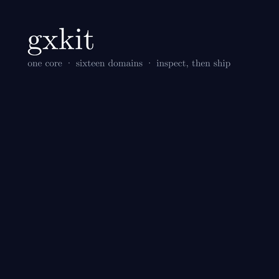
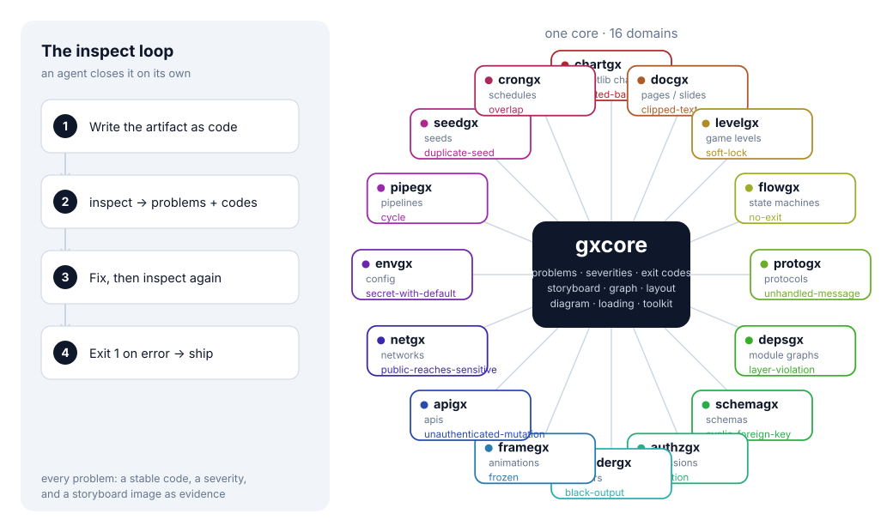
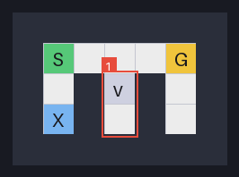

# gxkit

**Agent-native review loops for creative artifacts.** Its job is simple: let an
AI check its own work *before* you have to. Write the artifact as code,
`inspect` it, get problems with stable codes and an exit code, fix them, and
ship — with a storyboard image as the evidence.

> **Set up with a prompt.** Paste into Claude Code, Codex, or Cursor — the agent
> installs and runs it:
>
> ```
> Follow https://raw.githubusercontent.com/nekomario28/gxkit/main/llms.txt. Install gxkit, then inspect <your file>.
> ```

<p>
<a href="https://github.com/nekomario28/gxkit/actions/workflows/ci.yml"></a>


</p>

<p align="center"></p>

<p align="center"><sub>One core, sixteen domains. The 3D is rendered with <a href="https://manimgx.academa.ai/">ManimGX</a> — the renderer gxkit's <code>framegx</code> inspects.</sub></p>



## Start with one tool

Most people have one kind of artifact, and most of these tools read a file you
already have — a chart script, a rendered video, a published API spec — with no
declaration to write:

```sh
uvx chartgx inspect my_chart.py          # a plain matplotlib script
uvx apigx  inspect openapi.json          # the spec your service publishes
uvx framegx inspect clip.py              # the video your renderer wrote
```

`chartgx` runs the script and reads the figure it builds; `apigx` converts the
OpenAPI 3 document and applies the same codes as a declaration; `framegx`
probes the encoded file. Nothing here needs a gxkit-specific declaration.

Want all sixteen? Install the family instead — the contract is identical:

```sh
uvx --from "git+https://github.com/nekomario28/gxkit#subdirectory=packages/gxkit" gxkit tools
```

## The loop

Every tool has the same contract, so an agent learns it once:

```sh
<tool> inspect artifact.py     # report + storyboard; exit 1 on any error
<tool> inspect artifact.py --json
<tool> render  artifact.py -o out.png
```

- **Exit 1** on any `error`; `warn` and `info` never fail the build.
- **Stable codes** — `truncated-baseline`, `soft-lock`, `escalation`, … — so an
  agent branches on the code, never on prose.
- **A storyboard image** with each located problem boxed and numbered, so the
  text report and the picture agree.

**Keep history.** Compare a run to an accepted state, so CI fails only on *new*
errors and old debt is visible as it shrinks:

```sh
<tool> inspect artifact.py --write-baseline .gxkit-baseline.json   # accept today
<tool> inspect artifact.py --baseline .gxkit-baseline.json         # new / fixed / unchanged
```

The baseline is plain JSON — commit it. Format 2 preserves repeated findings
and explicit relationship identities. Older baselines are rejected: review the
current findings, then deliberately recreate accepted debt with `--write-baseline`.
Without a baseline, any `error` fails. An input that cannot be inspected exits 2.

**One entry point.** With the family installed you don't have to know which tool
fits — it reads the artifact and routes:

```sh
uv run gxkit tools              # what can be inspected
uv run gxkit inspect chart.py   # detect the artifact and route it
uv run gxkit codes              # every problem code and its severity
```

A document that is not a Python artifact (an `openapi.json`) needs its tool
named once: `gxkit inspect apigx openapi.json`.

## Tools

| tool | inspects | the check only it makes |
| --- | --- | --- |
| `chartgx` | matplotlib charts | a bar chart whose baseline is not zero |
| `levelgx` | game levels | a soft-lock created by a one-way tile |
| `flowgx` | state machines | a state from which "done" is unreachable |
| `protogx` | protocols | a declared message nothing handles |
| `authzgx` | permission models | a low principal reaching a sensitive permission |
| `depsgx` | module graphs | a lower layer importing a higher one |
| `schemagx` | schemas | a foreign-key cycle |
| `docgx` | pages / slides | text that overflows the canvas |
| `shadergx` | fragment shaders | a uniform that never reaches the output |
| `framegx` | rendered animations | a render that is frozen or black |
| `apigx` | HTTP API contracts | a mutating route with no authentication |
| `netgx` | network topologies | a public entry that reaches sensitive data |
| `envgx` | environment / config | a secret that carries a default |
| `pipegx` | build pipelines | a `needs` that names no step |
| `seedgx` | random-seed manifests | two streams that share a seed |
| `crongx` | schedules | two runs that hold a resource at once |

Each tool also ships `README.md`, `AGENTS.md`, `llms.txt` and `SKILL.md`; the
repository root has [`SKILL.md`](SKILL.md), the family skill that routes to them
all. [`docs/TRACE.md`](docs/TRACE.md) maps each tool to its module, its codes and
its examples (generated, so it cannot drift).

> **Pairs with ManimGX.** A renderer makes the 3D animation; gxkit checks the
> result. ManimGX's `inspect` reads the *scene* before rendering; `framegx`
> reads the *encoded file* after — black, frozen, wrong length, silent. So
> `manimgx render scene.py && framegx inspect clip.py` closes the loop. gxkit is
> an independent project, not affiliated with ManimGX or Academa.

## See it catch something

Here is a level an agent wrote. Every cell is reachable, so a naive check
passes — but a one-way tile drops the player into a dead end. `levelgx` walks
the *directed* graph and finds it (the picture below is generated from the same
data):



```sh
$ levelgx inspect softlock.py
inspect: 1 problem (1 error)
  [1] error cell r2c3  soft-lock: 2 reachable cells cannot get back to the goal
                        (e.g. cell r2c3) — a one-way tile makes a dead end
$ echo $?
1
```

The text says which cell; the storyboard image boxes it. That is the whole
idea, repeated for sixteen domains.

## One core, thin tools

The expensive part of a review loop is the contract, not the checks. `gxcore`
owns it — `model`, `report`, `cli`, `storyboard`, `testing` — plus the analysis
the tools share:

- **`graph`** — reachability, reverse reachability, traps (soft-locks), cycles.
- **`layout`** — text too small, clipped, or overlapping.
- **`diagram`** — a deterministic node-link renderer.
- **`loading`** and **`toolkit`** — load an artifact from a file; build a tool
  from three callables.

A new tool is a loader, a checks module and a renderer; its `tool.py` is about
twenty lines. See [`docs/BUILDING.md`](docs/BUILDING.md).

## Install

```sh
# run without installing
uvx --from "git+https://github.com/nekomario28/gxkit#subdirectory=packages/chartgx" chartgx inspect chart.py
# or put it on PATH
uv tool install "git+https://github.com/nekomario28/gxkit#subdirectory=packages/chartgx"
# or install the whole family behind one `gxkit` command
uv tool install "git+https://github.com/nekomario28/gxkit#subdirectory=packages/gxkit"
```

Replace `chartgx` with any tool above. Needs Python 3.10+; `chartgx` also needs
matplotlib, and `shadergx` needs a GL context (Mesa/EGL or a GPU).

## Use in CI

A reusable action runs `gxkit inspect` and fails the job on an `error`:

```yaml
permissions:
  contents: read          # the action only needs to read
jobs:
  inspect:
    runs-on: ubuntu-latest
    steps:
      - uses: actions/checkout@v4
      - uses: nekomario28/gxkit@v0.9.1
        with:
          path: artifacts/          # a file, or a directory of *.py artifacts
          args: --json              # optional extra flags
          # tool: chartgx           # optional: install just one tool
```

The action **runs the artifact** to inspect it (see [`SECURITY.md`](SECURITY.md)),
so run it on an ephemeral runner with no secrets, and not on files you do not
trust.

## Configure

A `.gxkit.toml` anywhere up the tree from the artifact is read by every tool:

```toml
ignore = ["no-units"]           # drop a note everywhere
[severity]
dual-axis = "error"             # promote a warning to a failure
[chartgx]
ignore = ["red-green"]          # ...or only for one tool
```

Pass `--no-config` to ignore it.

## Develop

```sh
uv sync --all-packages
uv run pytest
uv run chartgx inspect packages/chartgx/examples/bad_chart.py   # exit 1
uv run framegx  inspect packages/framegx/examples/frozen_clip.py   # exit 1
python scripts/prepublish_check.py      # no credentials or machine paths
python scripts/make_readme_figure.py    # regenerate the architecture figure
# the 3D hero is made with ManimGX (scene in docs/hero/):
uvx --python 3.14 manimgx render docs/hero/gxkit_hero.py -r 720x720 --fps 24
```

## Documentation

- [`SKILL.md`](SKILL.md) — the family agent skill; routes to each tool's skill.
- [`docs/BUILDING.md`](docs/BUILDING.md) — how to add a tool: the checklist, the
  contract, the extraction rule, the pitfalls.
- [`docs/CONTRACT.md`](docs/CONTRACT.md) — what an integrator may rely on:
  codes, exit codes, the JSON report, the baseline, and what is explicitly not
  promised.
- [`docs/PLAN.md`](docs/PLAN.md) — goals and roadmap.
- [`docs/LICENSING.md`](docs/LICENSING.md) — why MIT, and acknowledgements.
- [`docs/agent-native-landscape.md`](docs/agent-native-landscape.md) — which
  domains are still empty.

## Security

`inspect` reads the artifact by **importing and running the Python file** you
give it — only run it on files you trust. `shadergx` additionally runs GLSL on
your GPU. No tool makes network requests. Before publishing, run
`python scripts/prepublish_check.py`.

## License

MIT. Every package declares an SPDX `License-Expression` and ships its `LICENSE`
in the wheel; see [`docs/LICENSING.md`](docs/LICENSING.md).
